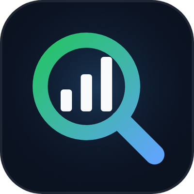

<p align="center">
  
</p>

<h1 align="center">Wrenfield Data MCP</h1>

<p align="center"><b>SEO and AI-search data, priced per result.</b><br>
Keyword, domain, AI-visibility and lead data for AI agents, as remote MCP servers. Nothing to install or host.</p>

<p align="center">
  <a href="https://wrenfielddata.com"></a>
  <a href="https://apify.com/wrenfield-data"></a>
  
  
  <a href="LICENSE"></a>
</p>

---

## What this is

Wrenfield Data publishes data tools as [Apify Actors](https://apify.com/wrenfield-data). This repo bundles them into three ready-made **MCP servers** (one per suite), served by the [Apify MCP server](https://docs.apify.com/platform/integrations/mcp) at `mcp.apify.com`. Point your MCP client at a suite URL, sign in to Apify (OAuth) or pass an Apify API token, and each Actor appears as a tool with typed input and output schemas.

- **No server to run.** Apify hosts the MCP endpoint and runs the tools.
- **Pay per result.** Each tool charges for the results it returns, billed to your Apify account. Some tools add a small per-run or per-request fee, listed in the tables below. There's no subscription, and you don't need third-party API keys. The Apify Free plan includes a monthly usage credit.
- **Capped spend.** Agents can pass `callOptions.maxTotalChargeUsd` on any call. REST callers can use the `maxTotalChargeUsd` query parameter.
- **Also a plain API.** Every tool is a normal Apify Actor you can call over REST, from Python or Node, or from n8n/Make/Zapier ([examples](#rest-python-and-node)).

| Suite | For | Endpoint |
|---|---|---|
| [SEO Data](#1-seo-data) | keyword volume and CPC, domain authority and traffic, trends, competitor ads | `wrenfield-seo` |
| [AI Search Visibility](#2-ai-search-visibility) | how ChatGPT, Perplexity, Gemini, Claude and Google AI answers mention and cite a brand | `wrenfield-ai-search` |
| [Local Leads](#3-local-leads) | contacts, tech stack and domains for business lead lists | `wrenfield-leads` |

## Quick start

1. Get an Apify account (free) at [apify.com](https://apify.com). This step is optional if your client supports OAuth, because you sign in when you connect.
2. Pick a suite URL below. All three can run side by side.
3. Add it to your client ([Claude](#claude-desktop-and-claude-code), [Cursor](#cursor), [VS Code](#vs-code-github-copilot), [ChatGPT](#chatgpt), [others](#other-clients)).

Example prompts once connected:

> *"Get US search volume and CPC for 'crm software', 'best crm for small business' and 'free crm', and tell me which has the best volume-to-CPC ratio."*
>
> *"Compare domain authority and organic traffic for hubspot.com, pipedrive.com and zoho.com."*
>
> *"Ask ChatGPT and Perplexity 'What is the best CRM for a small business?' and tell me whether HubSpot is mentioned and which URLs are cited."*
>
> *"Find the official domains for these 20 company names, then pull their contact emails and CMS."*

---

## 1. SEO Data



Keyword research, domain-level SEO data, search trends and competitor ads. Keyword and domain metrics come from licensed sources (Google Ads Keyword Planner data and DataForSEO), not from scraping Ahrefs or Semrush.

<!-- BEGIN:url:seo-data -->
```text
https://mcp.apify.com?tools=wrenfield-data/keyword-search-volume,wrenfield-data/domain-authority-traffic-checker,wrenfield-data/google-trends-scraper,wrenfield-data/google-ads-transparency-scraper
```
<!-- END:url:seo-data -->

<!-- BEGIN:table:seo-data -->
| | Tool (MCP name) | What it returns | Price (Apify Free plan) |
|---|---|---|---|
|  | [`wrenfield-data--keyword-search-volume`](https://apify.com/wrenfield-data/keyword-search-volume) | Google Keyword Planner search volume, CPC, competition and 12-month trend per keyword, plus keyword ideas | $0.004 per keyword result ($4.00 / 1,000)<br><sub>also $0.15 per Google Ads live request; $0.08 per Google Ads queued request</sub> |
|  | [`wrenfield-data--domain-authority-traffic-checker`](https://apify.com/wrenfield-data/domain-authority-traffic-checker) | Domain rank, backlinks, referring domains, spam score and estimated organic/paid traffic, in bulk | $0.005 per domain result ($5.00 / 1,000)<br><sub>also $0.20 per domain report; $0.001 per run start</sub> |
|  | [`wrenfield-data--google-trends-scraper`](https://apify.com/wrenfield-data/google-trends-scraper) | Interest over time and by region, related queries and topics, and Trending Now by country | $0.003 per search term analysed ($3.00 / 1,000)<br><sub>also $0.0005 per trending search</sub> |
|  | [`wrenfield-data--google-ads-transparency-scraper`](https://apify.com/wrenfield-data/google-ads-transparency-scraper) | A competitor's Google ads from the Ads Transparency Center: text, images, videos, regions, dates | $0.0015 per ad result ($1.50 / 1,000)<br><sub>also $0.001 per run start</sub> |
<!-- END:table:seo-data -->

<!-- BEGIN:soon:seo-data -->
**Coming soon** (being published on Apify Store this week; not callable yet):

- `wrenfield-data--keyword-research-tool`: Keyword ideas with volume, CPC, keyword difficulty, intent and SERP features in one row
- `wrenfield-data--seo-toolkit`: Domain overview, ranked keywords, competitors, backlinks and live SERPs in one Actor
- `wrenfield-data--competitor-keywords`: Every keyword a domain or page ranks for, with position, volume and estimated traffic
- `wrenfield-data--keyword-difficulty-checker`: Bulk keyword difficulty (0-100) and search intent
- `wrenfield-data--google-autocomplete-keyword-expander`: Long-tail keyword ideas from Google and YouTube Autocomplete
- `wrenfield-data--people-also-ask-scraper`: People Also Ask questions (up to 4 levels), related searches and AI Overview text
- `wrenfield-data--google-rank-tracker`: Google positions per keyword with change since last run and AI Overview citation check
- `wrenfield-data--bulk-pagespeed-checker`: PageSpeed Insights scores and real-user Core Web Vitals for hundreds of URLs
- `wrenfield-data--amazon-keyword-research`: Reverse ASIN lookup, Amazon keyword ideas and Amazon search volume
<!-- END:soon:seo-data -->

## 2. AI Search Visibility


Generative-engine optimization (GEO/AEO) data: run your prompts across AI assistants and see whether your brand is mentioned, how it's ranked and which URLs are cited, compared with your competitors.

<!-- BEGIN:url:ai-search-visibility -->
```text
https://mcp.apify.com?tools=wrenfield-data/ai-search-visibility-tracker,wrenfield-data/keyword-search-volume
```
<!-- END:url:ai-search-visibility -->

<!-- BEGIN:table:ai-search-visibility -->
| | Tool (MCP name) | What it returns | Price (Apify Free plan) |
|---|---|---|---|
|  | [`wrenfield-data--ai-search-visibility-tracker`](https://apify.com/wrenfield-data/ai-search-visibility-tracker) | Per prompt and AI engine: answer text, brand mention and rank, sentiment, cited URLs, share of voice | $0.04 per prompt check |
|  | [`wrenfield-data--keyword-search-volume`](https://apify.com/wrenfield-data/keyword-search-volume) | Google Keyword Planner search volume, CPC, competition and 12-month trend per keyword, plus keyword ideas | $0.004 per keyword result ($4.00 / 1,000)<br><sub>also $0.15 per Google Ads live request; $0.08 per Google Ads queued request</sub> |
<!-- END:table:ai-search-visibility -->

<!-- BEGIN:soon:ai-search-visibility -->
**Coming soon** (being published on Apify Store this week; not callable yet):

- `wrenfield-data--ai-answer-scraper`: Answers and cited sources from ChatGPT, Perplexity, Gemini, Google AI Mode and Claude
- `wrenfield-data--people-also-ask-scraper`: People Also Ask questions (up to 4 levels), related searches and AI Overview text
- `wrenfield-data--google-rank-tracker`: Google positions per keyword with change since last run and AI Overview citation check
<!-- END:soon:ai-search-visibility -->

## 3. Local Leads


Turn a list of businesses into a usable lead list: official domains, public contact details and the technology each site runs on.

<!-- BEGIN:url:local-leads -->
```text
https://mcp.apify.com?tools=wrenfield-data/website-contact-scraper,wrenfield-data/website-tech-stack-detector,wrenfield-data/company-name-to-domain
```
<!-- END:url:local-leads -->

<!-- BEGIN:table:local-leads -->
| | Tool (MCP name) | What it returns | Price (Apify Free plan) |
|---|---|---|---|
|  | [`wrenfield-data--website-contact-scraper`](https://apify.com/wrenfield-data/website-contact-scraper) | Emails, phone numbers and social profiles from a list of company websites, one row per site | $0.004 per website with contacts ($4.00 / 1,000) |
|  | [`wrenfield-data--website-tech-stack-detector`](https://apify.com/wrenfield-data/website-tech-stack-detector) | CMS, ecommerce platform, analytics, ad pixels, hosting, CDN and email provider for any site | $0.0025 per website analyzed ($2.50 / 1,000)<br><sub>also $0.00005 per run start</sub> |
|  | [`wrenfield-data--company-name-to-domain`](https://apify.com/wrenfield-data/company-name-to-domain) | Official website domain for each company name, with confidence score, LinkedIn URL and logo | $0.0015 per company resolved ($1.50 / 1,000)<br><sub>also $0.0001 per run start; $0.003 per Google search</sub> |
<!-- END:table:local-leads -->

<!-- BEGIN:soon:local-leads -->
**Coming soon** (being published on Apify Store this week; not callable yet):

- `wrenfield-data--businesses-without-websites`: Google Maps businesses with no website or a weak one, scored as leads
- `wrenfield-data--google-maps-grid-rank-tracker`: Google Maps rank on an N x N geo-grid with heatmap and competitors per pin
- `wrenfield-data--bulk-pagespeed-checker`: PageSpeed Insights scores and real-user Core Web Vitals for hundreds of URLs
<!-- END:soon:local-leads -->

### More Wrenfield Data Actors

These Actors aren't in a suite, but you can add any of them to a suite URL (`...,wrenfield-data/<name>`) or call them over REST.

<!-- BEGIN:table:more -->
| | Tool (MCP name) | What it returns | Price (Apify Free plan) |
|---|---|---|---|
|  | [`wrenfield-data--sec-form-d-scraper`](https://apify.com/wrenfield-data/sec-form-d-scraper) | SEC EDGAR Form D filings: companies that just raised money, with amounts, executives and contacts | $0.003 per filing result ($3.00 / 1,000)<br><sub>also $0.00005 per run start</sub> |
|  | [`wrenfield-data--ats-jobs-api`](https://apify.com/wrenfield-data/ats-jobs-api) | Jobs from Greenhouse, Lever, Ashby, Workday, Workable and SmartRecruiters in one schema | $0.0015 per job posting result ($1.50 / 1,000)<br><sub>also $0.005 per run start</sub> |
|  | [`wrenfield-data--google-jobs-scraper`](https://apify.com/wrenfield-data/google-jobs-scraper) | Google Jobs listings by keyword and location, with parsed salary and apply links | $0.002 per job result ($2.00 / 1,000)<br><sub>also $0.002 per run start</sub> |
|  | [`wrenfield-data--google-shopping-price-comparison`](https://apify.com/wrenfield-data/google-shopping-price-comparison) | Google Shopping offers per product (price, shipping, seller, stock) by keyword, barcode or URL | $0.002 per product result ($2.00 / 1,000)<br><sub>also $0.012 per barcode lookup; $0.0005 per offer result; $0.003 per product details; $0.001 per run start</sub> |
|  | [`wrenfield-data--walmart-product-scraper`](https://apify.com/wrenfield-data/walmart-product-scraper) | Walmart products: price, was-price, stock, seller, UPC, variants and reviews | $0.0035 per product with full details ($3.50 / 1,000)<br><sub>also $0.0012 per listing-only product; $0.0004 per review; $0.002 per run start</sub> |
|  | [`wrenfield-data--home-depot-lowes-scraper`](https://apify.com/wrenfield-data/home-depot-lowes-scraper) | Home Depot and Lowe's products with local store price, in-store stock and aisle | $0.004 per product with details ($4.00 / 1,000)<br><sub>also $0.002 per listing-only product; $0.0005 per customer review; $0.005 per run start</sub> |
|  | [`wrenfield-data--shopify-store-scraper`](https://apify.com/wrenfield-data/shopify-store-scraper) | Any Shopify store's products and variants, with a monitor mode that returns only changes | $0.001 per product result ($1.00 / 1,000)<br><sub>also $0.003 per change result; $0.002 per run start</sub> |
|  | [`wrenfield-data--tripadvisor-reviews-scraper`](https://apify.com/wrenfield-data/tripadvisor-reviews-scraper) | Tripadvisor reviews for hotels, restaurants and attractions | $0.001 per review ($1.00 / 1,000)<br><sub>also $0.003 per place summary; $0.00005 per run start</sub> |
|  | [`wrenfield-data--youtube-transcript-scraper`](https://apify.com/wrenfield-data/youtube-transcript-scraper) | YouTube transcripts as text, timestamped segments, SRT/VTT or RAG-ready chunks | $0.003 per transcript result ($3.00 / 1,000) |
|  | [`wrenfield-data--telegram-channel-scraper`](https://apify.com/wrenfield-data/telegram-channel-scraper) | Public Telegram channel posts with views, reactions and media, no login | $0.001 per post result ($1.00 / 1,000)<br><sub>also $0.002 per channel info</sub> |
<!-- END:table:more -->

<!-- BEGIN:prices-date -->
<sub>Prices pulled from Apify Store on 2026-10-19. They are Apify Free-plan rates; paid Apify plans get lower tiered rates. Each Actor's Store page is the authoritative price list. A "run start" fee is charged once per call.</sub>
<!-- END:prices-date -->

---

## Connect your client

Each suite URL is a standard Streamable HTTP MCP endpoint. You can authenticate in either of two ways:

- **OAuth (recommended):** add just the URL. On first connect your browser opens so you can sign in to Apify and approve access.
- **Bearer token:** send `Authorization: Bearer <YOUR_APIFY_TOKEN>`. Get the token from [Apify Console → Settings → API & Integrations](https://console.apify.com/settings/integrations). Keep it out of git.

Ready-made files for every client below are in [`configs/`](configs/).

### Claude Desktop and Claude Code

**Claude Desktop (remote connector):** go to Settings → Connectors → *Add custom connector*, paste a suite URL and sign in to Apify. Availability depends on your Claude plan.

**Claude Desktop (local, any plan):** merge [`configs/claude-desktop.json`](configs/claude-desktop.json) into `claude_desktop_config.json` and restart Claude. This runs Apify's open-source stdio server (`@apify/actors-mcp-server`, Node 18+) with the same tools:

```json
{
  "mcpServers": {
    "wrenfield-seo": {
      "command": "npx",
      "args": ["-y", "@apify/actors-mcp-server@latest", "--tools",
               "wrenfield-data/keyword-search-volume,wrenfield-data/domain-authority-traffic-checker,wrenfield-data/google-trends-scraper,wrenfield-data/google-ads-transparency-scraper"],
      "env": { "APIFY_TOKEN": "<YOUR_APIFY_TOKEN>" }
    }
  }
}
```

**Claude Code:** see [`configs/claude-code.sh`](configs/claude-code.sh). For example:

```bash
claude mcp add --transport http wrenfield-seo \
  "https://mcp.apify.com?tools=wrenfield-data/keyword-search-volume,wrenfield-data/domain-authority-traffic-checker,wrenfield-data/google-trends-scraper,wrenfield-data/google-ads-transparency-scraper" \
  --header "Authorization: Bearer $APIFY_TOKEN"
```

### Cursor

Add to `~/.cursor/mcp.json` (global) or `.cursor/mcp.json` (project). See [`configs/cursor.json`](configs/cursor.json). Cursor opens the Apify sign-in on first use.

```json
{
  "mcpServers": {
    "wrenfield-seo": {
      "url": "https://mcp.apify.com?tools=wrenfield-data/keyword-search-volume,wrenfield-data/domain-authority-traffic-checker,wrenfield-data/google-trends-scraper,wrenfield-data/google-ads-transparency-scraper"
    }
  }
}
```

To use a token instead, add `"headers": { "Authorization": "Bearer <YOUR_APIFY_TOKEN>" }`.

### VS Code (GitHub Copilot)

Save [`configs/vscode.json`](configs/vscode.json) as `.vscode/mcp.json`. VS Code prompts once for the token and stores it securely:

```json
{
  "inputs": [{ "type": "promptString", "id": "apify-token", "description": "Apify API token", "password": true }],
  "servers": {
    "wrenfield-seo": {
      "type": "http",
      "url": "https://mcp.apify.com?tools=wrenfield-data/keyword-search-volume,wrenfield-data/domain-authority-traffic-checker,wrenfield-data/google-trends-scraper,wrenfield-data/google-ads-transparency-scraper",
      "headers": { "Authorization": "Bearer ${input:apify-token}" }
    }
  }
}
```

To use OAuth instead, remove `headers` (and `inputs`).

### ChatGPT

On plans and workspaces where custom MCP connectors (developer mode) are enabled, go to Settings → Apps (or Plugins) → *Create* / *Add custom MCP server*. Paste a suite URL, choose **OAuth**, then sign in to Apify. Availability and menu names depend on your ChatGPT plan; see [OpenAI's guide](https://help.openai.com/en/articles/12584461).

### Other clients

- **Any client that supports remote MCP:** use [`configs/generic-oauth.json`](configs/generic-oauth.json) or [`configs/generic-bearer.json`](configs/generic-bearer.json).
- **Windsurf:** use [`configs/windsurf.json`](configs/windsurf.json) (`serverUrl`).
- **Cline:** use [`configs/cline.json`](configs/cline.json) (`"type": "streamableHttp"`).
- **Clients that only support stdio:** run `npx -y @apify/actors-mcp-server --tools wrenfield-data/<actor>,...` with `APIFY_TOKEN` set.
- **AI coding agents** that install servers for you can follow [`llms-install.md`](llms-install.md).

### Using the tools from an agent

- Each suite also loads Apify's helper tools `get-actor-run`, `get-dataset-items`, `get-key-value-store-record` and `abort-actor-run`. If a long run doesn't finish within the call, fetch its results with `get-dataset-items`.
- Cap spend per call with `callOptions.maxTotalChargeUsd`.
- Results are JSON rows with stable field names. Each Actor's Store page documents its input and output schema.
- Optional: add `&telemetry-enabled=false` to a URL to opt out of Apify MCP telemetry.

---

## REST, Python and Node

Every tool is a regular Apify Actor (`wrenfield-data~<actor-name>` in the API). The simplest call is `run-sync-get-dataset-items`, which runs the Actor and returns its results in one request (runs must finish within 300 s).

```bash
curl -s -X POST \
  "https://api.apify.com/v2/acts/wrenfield-data~keyword-search-volume/run-sync-get-dataset-items?maxTotalChargeUsd=1" \
  -H "Authorization: Bearer $APIFY_TOKEN" \
  -H "Content-Type: application/json" \
  -d '{"keywords": ["crm software", "free crm"], "location": "United States", "language": "English"}'
```

```python
import os, requests

r = requests.post(
    "https://api.apify.com/v2/acts/wrenfield-data~domain-authority-traffic-checker/run-sync-get-dataset-items",
    params={"maxTotalChargeUsd": 1},
    headers={"Authorization": f"Bearer {os.environ['APIFY_TOKEN']}"},
    json={"domains": ["hubspot.com", "pipedrive.com"]},
    timeout=320,
)
r.raise_for_status()
for row in r.json():
    print(row["domain"], row.get("organic_traffic"), row.get("domain_rank"))
```

```js
const res = await fetch(
  "https://api.apify.com/v2/acts/wrenfield-data~website-tech-stack-detector/run-sync-get-dataset-items?maxTotalChargeUsd=1",
  {
    method: "POST",
    headers: { Authorization: `Bearer ${process.env.APIFY_TOKEN}`, "Content-Type": "application/json" },
    body: JSON.stringify({ urls: ["wordpress.org", "allbirds.com"] }),
  },
);
for (const row of await res.json()) console.log(row.domain, row.technologies);
```

More in [`examples/`](examples/): curl scripts, Python (`requests` and `apify-client`) and Node (`fetch` and `apify-client`).

## Repository layout

```text
README.md            this file
suites.json          source of truth: which Actors are in each suite
configs/             copy-paste MCP configs per client
registry/<suite>/    server.json for the official MCP Registry
examples/            curl, Python and Node examples
assets/              logo, suite icons, tool icons
scripts/generate.py  regenerates configs, registry files and README tables from suites.json
llms-install.md      setup notes for AI coding agents
```

To change a suite, edit `suites.json` and run `python3 scripts/generate.py`. The script reads only public Apify Store data and refuses to list any Actor that isn't public.

## Acceptable use

The tools use public web pages and licensed data sources only, and none of them log in to websites. Lead tools return business contact details that are publicly listed. You are responsible for following GDPR, CAN-SPAM, TCPA and similar rules when you contact anyone.

## About

Wrenfield Data builds SEO, AI-search and lead data tools, priced per result.

- Website: [wrenfielddata.com](https://wrenfielddata.com)
- Apify Store: [apify.com/wrenfield-data](https://apify.com/wrenfield-data)
- YouTube: [@wrenfielddata](https://www.youtube.com/@wrenfielddata)
- Contact: [hello@wrenfielddata.com](mailto:hello@wrenfielddata.com)
- Bugs and requests: [GitHub issues](https://github.com/wrenfielddata/wrenfield-mcp/issues), or the Issues tab on each Actor's Store page

The MCP endpoint is operated by Apify ([apify/apify-mcp-server](https://github.com/apify/apify-mcp-server)). Wrenfield Data is an independent Apify Store publisher and isn't affiliated with Apify, Anthropic, OpenAI or Google. Product names are trademarks of their owners.

## License

[MIT](LICENSE). This covers the configs, examples and docs in this repo. Use of the tools is billed through Apify under [Apify's terms](https://docs.apify.com/legal).
